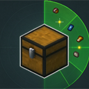

# Storage Radar

**Storage Radar** caches the containers you have opened nearby and turns their contents into a searchable, clickable item board. Pick what you want, and your character automatically walks to the container that holds it, opens it, and takes the selected items into your inventory.

A client-side Fabric mod for **Minecraft 1.21.11**. No mixins — public APIs only.

> 中文说明：[README.zh-CN.md](README.md)

I got the idea 💡 while watching Minecraft videos. Out of habit I often toss my stuff into random chests, so I built this mod to make retrieving items convenient — and I'm sharing it with everyone. (Also, for the record: this mod was made with AI.)

## Features

- **Storage radar** — every container ChestTracker remembers in the current dimension, within the radius (1–128 blocks, default 16).
- **Slot-level grid** — one cell = one whole stack in one slot of a container. Nothing is merged, so "take this cell" moves only that stack.
- **Double-chest layout** — 9×6 cells per page, your inventory below; page with the mouse wheel, arrow keys, or by typing a page number.
- **Bilingual search** — Chinese names, English names, pinyin, and pinyin initials (`钻石` / `zuanshi` / `zs` / `diamond`).
- **Multi-select** — left click toggles, Ctrl single-selects, Shift range-selects, Alt selects every identical stack on the page, Ctrl+A selects the whole page.
- **One trip per container** — selected cells are grouped by container: one walk, one opening, every selected cell inside taken.
- **Fully automatic retrieval** — shift-clicks the exact slot, waits for the server to confirm, then moves on to the next chest. Progress is shown above the hotbar.
- **masa-style config** — malilib-based config and hotkeys, bilingual rows, themed like Tweakeroo / MiniHUD.
- **Safe implementation** — only vanilla interactions are used (right-click to open, shift-click to take); no packets are faked.

## Requirements

| Component | Notes |
| --- | --- |
| Minecraft **1.21.11** | client side only |
| [Fabric Loader](https://fabricmc.net/use/) **0.16+** | tested with 0.19.5 |
| **Java 21** | required by 1.21.11 |
| [malilib](https://masa.dy.fi/mcmods/malilib/) | **required** — config, hotkeys, GUI framework |
| [Fabric API](https://modrinth.com/mod/fabric-api) | malilib dependency |
| [ChestTracker](https://modrinth.com/mod/chest-tracker) | **required at runtime** — item data comes from its container memory. Needs a 1.21.11 build (tested with 2.8.4) |
| [Baritone](https://github.com/cabaletta/baritone) | **required for distant containers**. Without it you can only take from containers within ~4.5 blocks |
| [Mod Menu](https://modrinth.com/mod/modmenu) | optional — provides the mod-list entry and config button |

## Installation

1. Install Fabric Loader 0.16+ for Minecraft 1.21.11.
2. Put the dependencies into `mods/`: malilib, Fabric API, ChestTracker, Baritone (plus Mod Menu if you want the config button).
3. Put `storage-radar-1.0.0+mc1.21.11.jar` into `mods/`.
4. Launch the game; the mod is named **Storage Radar**.

## Quick start

1. Open containers normally first — ChestTracker records what is inside.
2. Press **B** (default) to open Storage Radar.
3. Search or page to the item, then left-click a cell to select it.
4. Right-click a cell = **take only the item under the mouse**; or hover a cell and press **R**.
5. The mod paths, opens the container and takes the items. Press **ESC** to stop at any time.

## Controls

Full reference: [docs/KEYBINDS.md](docs/KEYBINDS.md)

| Action | Default |
| --- | --- |
| Open Storage Radar | **B** |
| Take hovered slot / all selected | **R** (inside the GUI) |
| Take just this slot | **Right click** on a cell |
| Select / deselect | **Left click** on a cell |
| Range select | **Shift + Left click** |
| Select every identical stack on the page | **Alt + Left click** |
| Take all selected | **Tab / R** |
| Stop | **ESC** |

Some keyboard hotkeys can be changed in this mod's config screen (or malilib's hotkey list). Mouse actions inside the GUI are fixed.

## Configuration

Full reference: [docs/CONFIG.md](docs/CONFIG.md)

| Option | Default | Effect |
| --- | --- | --- |
| Radius | 16 | Search radius in blocks around the player (1–128) |
| Sort by count | on | Sort by stack size, largest first; equal counts by distance. Off = sort by distance only |
| Show container location | on | On hover: container name, coordinates, slot index, distance |
| Allow breaking while pathing | off | Let Baritone break blocks on the way (previous value is restored afterwards) |
| Close GUI after taking | on | Close the radar when a take starts, and close the container screen once a container is emptied |
| Reopen radar after taking | off | Reopen the radar screen after the whole batch is done |
| Only named containers | off | Only list containers that have a custom name |

## How it works

- **ChestTracker is the data source.** Storage Radar only reads the container contents it remembers; it does not scan the world.
- **One row = one slot**, not one item type: three stacks of diamonds in the same chest are three rows.
- **Retrieval is grouped by container** (dimension + position): one pathing trip, one container opening, then every selected cell inside is shift-clicked.
- Opening uses a normal right-click and taking uses shift-click, so the server only sees ordinary player actions.
- No mixins — everything goes through public APIs, so it coexists with Tweakeroo / MiniHUD / Litematica and other malilib mods.

## Known limitations

- **Current dimension only.** Containers in other dimensions are not listed and are not retrieved automatically.
- **Only containers ChestTracker has recorded.** A chest you have never opened will not appear.
- **The cache can be stale.** Counts are a snapshot; if a slot was already emptied by someone else, you get a "this slot is empty (cache is out of date)" message and it moves on.
- **Server rules are your responsibility.** Automated walking and container opening may violate some servers' rules — use at your own risk.
- No cross-dimension handling, no special ender-chest handling, no remote container access.

## FAQ

| Symptom | Cause / fix |
| --- | --- |
| "ChestTracker is not installed" message | Install ChestTracker and restart the game |
| The list is empty | Open a few containers first; or increase the radius; or ChestTracker's memory bank is not loaded yet |
| "This slot is empty (cache is out of date)" | The cache is an old snapshot — open that chest again, then press **Refresh** |
| It never walks to distant containers | Baritone is missing, or Baritone cannot find a path; containers farther than ~4.5 blocks need Baritone |
| Key conflict | Rebind it in the config screen |
| "Window too small / GUI scale too large" | Enlarge the window or lower the GUI scale |

## Building from source

This mod is deliberately kept simple: there is no Gradle project. It is compiled with `javac` directly against the **intermediary-mapped** 1.21.11 client jar, together with the malilib / ChestTracker / Baritone / ModMenu jars, then packaged with its resources. The sources in the repository already use intermediary names (`class_...`, `method_...`), so no remapping is needed and the produced jar works as-is.

That toolchain is specific to the author's workspace, so the repository provides the source for reading and the built jar is published in Releases. No mixins, no generated code.

## License

[MIT](LICENSE)

Author: **YXiaoIBaiY  BiliBili爱吐槽的小白**
