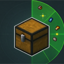

# 存储雷达（Storage Radar）

**存储雷达**把附近打开过的箱子缓存，把缓存的物品放入一个可搜索、可点击的物品展示栏。选中想要的物品，人物就会自动走过去寻找物品所在的箱子并打开箱子，把选中的物品自动取到背包内。

客户端 Fabric 模组，适用于 **Minecraft 1.21.11**。不包含任何 mixin，只用公开 API。

> English: [README.EN.md](README.EN.md)

我在刷我的世界视频时得到灵感💡从而做出这个模组，因为我自己的习惯我经常把东西随便放到箱子内，做出这个模组为了方便拿取物品，顺便分享给大家使用。（另外说明这个模组是AI制作）

## 功能

- **存储雷达** — 当前维度内、半径（1–128 格，默认 16）以内所有 ChestTracker 记住的容器。
- **槽位级网格** — 一格 = 某个容器某个槽位里的一整组。不做合并，所以「取这一格」只搬这一组。
- **大箱子式界面** — 每页 9×6 格，下方是你的背包；滚轮、方向键、输入页码都能翻页。
- **中英双语搜索** — 支持中文名、英文名、拼音、首字母（`钻石` / `zuanshi` / `zs` / `diamond`）。
- **多选** — 左键切换选中，Ctrl 单选，Shift 连选，Alt 选中本页所有相同物品，Ctrl+A 全选本页。
- **一箱一次行程** — 选中的多格按容器归并：走过去一次、开箱一次，把箱内选中的每一格都取完。
- **全自动取物** — 自动对准确槽位 shift 点击、等服务器回包确认，再收尾去下一个箱子。进度显示在物品栏上方。
- **masa 风格配置** — 基于 malilib 的配置与热键，中英双行标签，外观与 Tweakeroo / MiniHUD 一致。
- **安全实现** — 全程只用原版交互（右键开箱、shift 点击取物），不伪造任何数据包。

## 前置要求

| 组件 | 说明 |
| --- | --- |
| Minecraft **1.21.11** | 仅客户端 |
| [Fabric Loader](https://fabricmc.net/use/) **0.16+** | 实测 0.19.5 |
| **Java 21** | 1.21.11 要求 |
| [malilib](https://masa.dy.fi/mcmods/malilib/) | **必需** — 配置、热键、界面框架 |
| [Fabric API](https://modrinth.com/mod/fabric-api) | malilib 的前置 |
| [ChestTracker](https://modrinth.com/mod/chest-tracker) | **运行时必需** — 物品数据来自它的容器记忆。需要 1.21.11 版本（实测 2.8.4） |
| [Baritone](https://github.com/cabaletta/baritone) | **去远处容器必需**。没有它只能取约 4.5 格以内的容器 |
| [Mod Menu](https://modrinth.com/mod/modmenu) | 可选 — 提供模组列表条目和配置按钮 |

## 安装

1. 给 Minecraft 1.21.11 安装 Fabric Loader 0.16+。
2. 把前置放进 `mods/`：malilib、Fabric API、ChestTracker、Baritone（想要配置按钮再加 Mod Menu）。
3. 把 `storage-radar-1.0.0+mc1.21.11.jar` 放进 `mods/`。
4. 启动游戏，模组名为 **Storage Radar**（中文名「存储雷达」）。

## 快速上手

1. 先正常打开一遍箱子 —— ChestTracker 会记录里面的东西。
2. 按 **B**（默认键）打开存储雷达。
3. 搜索或翻页找到物品，左键点格子选中。
4. 右键点格子 = **只取鼠标选中的物品**；或者把鼠标悬停在格子上按 **R**。
5. 模组自动寻路、开箱、取物。中途想停按 **ESC**。

## 操作说明

完整说明：[docs/KEYBINDS.zh-CN.md](docs/KEYBINDS.zh-CN.md)

| 操作 | 默认 |
| --- | --- |
| 打开存储雷达 | **B** |
| 取悬停格 / 取全部选中 | **R**（界面内） |
| 只取这一格 | 格子上 **右键** |
| 选中 / 取消选中 | **左键**点格子 |
| 连选 | **Shift + 左键** |
| 选中本页所有相同物品 | **Alt + 左键** |
| 取全部选中 | **Tab/R** |
| 停止 | **ESC** |

一些键盘热键能在本模组配置界面里改（或 malilib 的热键列表）。界面内的鼠标操作固定不可改。

## 配置

完整说明：[docs/CONFIG.zh-CN.md](docs/CONFIG.zh-CN.md)

| 选项 | 默认 | 作用 |
| --- | --- | --- |
| 检索半径 | 16 | 以玩家为中心的检索半径（1–128 格） |
| 按数量排序 | 开 | 按堆叠数量从大到小排，数量相同按距离；关掉则纯按距离 |
| 显示容器位置 | 开 | 悬停时显示容器名、坐标、槽位号、距离 |
| 寻路允许破坏 | 关 | 允许 Baritone 路上拆方块（结束后恢复原值） |
| 取完关闭界面 | 开 | 开始取物时关闭雷达界面，取完一个容器后关闭箱子界面 |
| 取完重开界面 | 关 | 整批取完后重新打开雷达界面 |
| 只看命名容器 | 关 | 只列出改过名的容器 |

## 工作原理

- **ChestTracker 是数据源。** 存储雷达只读它记住的容器内容，不扫描世界。
- **一行 = 一个槽位**，不是一种物品：同一个箱子里三组钻石就是三行。
- **取物按容器归并**（维度 + 坐标）：一次寻路、一次开箱，把箱内选中的每一格 shift 点击取完。
- 开箱用普通右键，取物用 shift 点击，服务器看到的都是正常玩家操作。
- 不含 mixin，全部走公开 API，因此能和 Tweakeroo / MiniHUD / Litematica 等 malilib 系模组共存。

## 已知限制

- **只处理当前维度。** 其它维度的容器不会列出，也不会自动跨维度去取。
- **只认 ChestTracker 记录过的容器。** 没开过的箱子不会出现。
- **缓存可能过期。** 数量是快照；如果那一格已被别人拿走，会提示「这一格已空（缓存过期）」然后跳过。
- **服务器规则自己确认。** 自动行走与自动开箱在某些服务器可能违规，风险自负。
- 不处理跨维度、不特殊处理末影箱、不远程开箱。

## 常见问题

| 现象 | 原因 / 处理 |
| --- | --- |
| 提示「未安装 ChestTracker」 | 装 ChestTracker 后重启游戏 |
| 列表是空的 | 先打开几个箱子；或调大检索半径；或 ChestTracker 的记忆库还没加载 |
| 「这一格已空（缓存过期）」 | 缓存是旧快照 —— 重新开一次那个箱子再按 **刷新** |
| 不会走去远处容器 | 没装 Baritone，或 Baritone 找不到路；超过约 4.5 格的容器需要 Baritone |
| 按键冲突 | 在配置界面里改键 |
| 「窗口太小 / GUI 尺度太大」 | 放大窗口或调低 GUI Scale |

## 从源码构建

本模组刻意保持简单，没有 Gradle 工程：用 `javac` 直接对 **intermediary 映射**的 1.21.11 客户端 jar 编译，搭配 malilib / ChestTracker / Baritone / ModMenu 的 jar，然后连同资源打包。仓库里的源码本身就是 intermediary 名字（`class_...`、`method_...`），因此不需要 remap，产出的 jar 直接可用。

这套工具链是作者工作区专用的，所以仓库提供源码供阅读，成品 jar 放在 Releases。没有 mixin，也没有生成代码。

## 许可证

[MIT](LICENSE)

作者：**YXiaoIBaiY BiliBili爱吐槽的小白**
